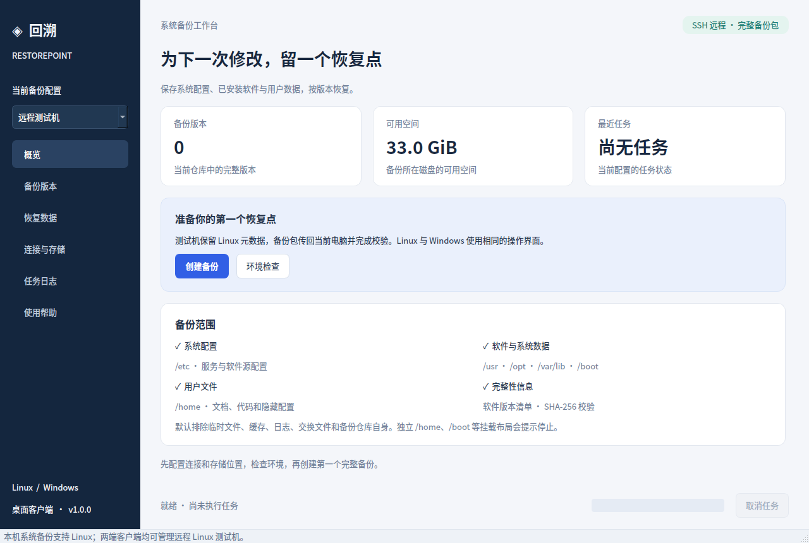

# RestorePoint · 回溯

使用 **Python + PySide6 / Qt 6** 构建的桌面备份工具。支持 Linux 本地快照，以及从
Windows 或 Linux 客户端通过 SSH 管理 Linux 测试机的备份与恢复。



## 功能

- Linux 本地备份：rsync + 硬链接，多版本共享未变化文件。
- 远程备份：保留 Linux 元数据的完整备份包，通过 SSH/SFTP 保存到客户端。
- 系统与用户目录分别保存，包含配置、软件文件、软件数据库和用户隐藏配置。
- 版本列表、搜索、详情与 SHA-256 校验。
- 用户文件恢复和系统恢复预览；预览后显式执行恢复。
- 多机器配置、SSH 密钥 / 密码认证、主机指纹核对和远程组件部署。
- 后台任务、实际传输进度、取消请求、任务历史与日志导出。
- 原本的 Python / PowerShell 命令行入口继续保留。

## 支持范围

| 客户端 | Linux 本地快照 | 管理远程 Linux | 保存远程备份包 |
| --- | --- | --- | --- |
| Linux | 支持 | 支持 | 支持 |
| Windows | 不适用 | 支持 | 支持 |

Windows 客户端无需 WSL；本项目不备份 Windows 操作系统本身。
Linux 来源目前面向 Debian/Ubuntu，要求根目录、home、boot 等位于同一文件系统。
检测到独立 `/home`、`/boot`、EFI 等挂载点时会停止，尚未实现多文件系统自动备份。

## 启动桌面应用

源码运行建议 Python 3.10+。在项目目录建立虚拟环境并安装依赖。

Linux：

```bash
python3 -m venv .venv
.venv/bin/python -m pip install -r requirements-gui.txt
.venv/bin/python app.py
```

Windows PowerShell：

```powershell
py -3 -m venv .venv
.venv/Scripts/python.exe -m pip install -r requirements-gui.txt
.venv/Scripts/python.exe app.py
```

Linux 备份引擎还需要 rsync、GNU tar、gzip、sudo、findmnt、dpkg-query 和 apt-mark。
已打包程序自带 Python 和 Qt 运行库，系统备份工具仍需安装在 Linux 来源机器上。

首次使用时，在「连接与存储」选择模式、设置路径并保存配置。远程模式先检查 SSH
连接、核对主机指纹并部署组件，再执行环境检查和创建备份。界面内提供完整操作帮助。

## 使用说明

- [Qt 界面、配置和打包](GUI.md)
- [Linux 本地命令行备份与恢复](LOCAL.md)
- [原生 Windows PowerShell 远程管理](REMOTE.md)
- [连接配置模板](remote.config.example.json)
- [恢复界面截图](screenshots/restore.png)

SSH / sudo 密码仅供当前任务使用，不写入配置或日志。配置导出仅包含参数和私钥文件
路径，不包含私钥内容。Linux 系统仓库受 root 权限保护，备份包也应妥善限制访问。

## 打包

在目标操作系统上执行：

```bash
python -m pip install -r requirements-gui.txt pyinstaller
python build_desktop.py
```

Linux 输出 `dist/RestorePoint/RestorePoint`，Windows 输出
`dist/RestorePoint/RestorePoint.exe`。分发时需保留整个 `RestorePoint` 目录。
Linux 二进制与构建系统的 glibc 和 CPU 架构有关，需要兼容旧系统时应在对应系统上构建。

仓库包含 [双平台 GitHub Actions 工作流](.github/workflows/desktop.yml)，可在 Actions
页面手动触发测试和构建，生成 Linux 程序包与 Windows 程序包。

## 验证

```bash
QT_QPA_PLATFORM=offscreen .venv/bin/python -m unittest -v test_snapshot.py test_portable.py test_desktop.py
```

Windows 运行桌面层测试：

```powershell
$env:QT_QPA_PLATFORM = 'offscreen'
.venv/Scripts/python.exe -m unittest -v test_desktop.py
```

Linux 开发环境已通过 23 项隔离测试，并完成 Qt 离屏渲染与打包程序启动检查。
测试覆盖本地版本、元数据还原、损坏包拦截、恢复保护、文件传输适配、后台任务及日志
脱敏。Windows 实机和真实 SSH 联机尚待验证，完整系统启动恢复也尚未演练。

## 恢复边界

备份以文件为单位，不包含分区表、引导扇区或内存状态。系统恢复需要 Live ISO / 救援
环境，目标是独立挂载的系统分区；引擎拒绝覆盖运行中的根目录。恢复后按需检查引导。

备份不会冻结整台机器。重要数据库应提前暂停或做应用自身的导出，避免在软件更新时
备份。同盘快照适合处理误操作和升级故障；磁盘损坏会同时影响同盘备份。

新版本仅在完成后发布，失败目录保留供检查。默认不自动删除历史版本；远程完整包会
临时占用测试机空间，也会比共享硬链接的本地快照使用更多存储空间。
